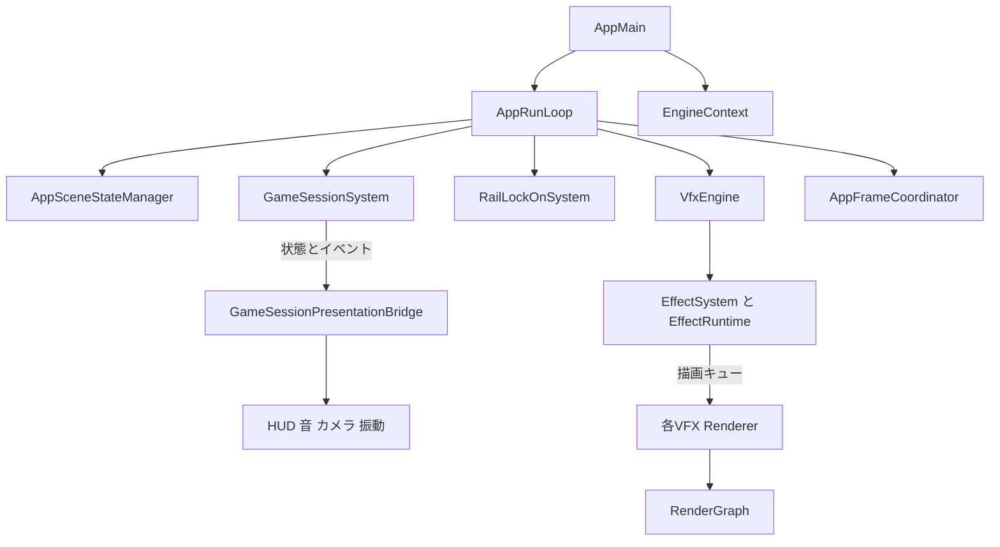

# クラス設計とコーディングの面接対策

2026年10月29日時点の作業ツリーを対象にした、作品「レールであばレール」のコードレビュー説明用資料。

この作品で説明の中心に据えやすいのは、**ゲームの判定と演出を分ける設計、操作感を支えるロックオン処理、描画リソースを管理するRenderGraph**。技術名だけでなく、「どの問題を解くために分けたか」「実装でどのように防いでいるか」「残る制約」を一組で話す。

## 最初の説明例

> C++とDirectX 12を使ったレールシューティング作品です。ゲームの進行や勝敗を決める処理と、HUDや音などの演出を分けている点が設計上の特徴です。ロックオンは候補収集、照準操作、補助、対象確定に分け、操作感を個別に調整できるようにしています。描画では各パスが使うリソースを宣言し、RenderGraphで状態遷移や不要パスの除外、一時リソースの再利用計画をまとめています。

この説明例はコードの構成を説明するもの。自身の担当範囲、実際に困ったこと、採用までの経緯は、自分の制作経験に合わせて補う。

## 全体のクラス構成

| 領域 | 主なクラスや型 | 責務 |
| --- | --- | --- |
| 起動と構築 | `AppMain`、`AppBootstrap`、`EngineContext` | ウィンドウやDirectX 12基盤を準備し、アプリケーションの依存を接続する |
| 全体の進行 | `AppRunLoop` | ゲーム、エディタ、描画などを接続してフレームを進める |
| シーン切替 | `AppSceneStateManager`、`IAppSceneState` | 現在のシーンと次のシーンを保持し、入退場、更新、描画を呼ぶ |
| コース進行 | `CourseAsset`、`CourseRuntime`、`CourseEventDispatcher` | 定義データ、走行距離とイベント進行、出現処理を分担する |
| ゲームルール | `GameSessionSystem` | HP、スコア、ポーズ、勝敗、リトライ可否を管理する |
| ゲームの演出 | `GameSessionPresentationBridge`、HUD関連クラス | 確定した状態とイベントを表示用データや演出指示へ変換する |
| 照準とロックオン | `RailLockOnSystem`とその構成要素 | 対象収集、入力、補助、レイ判定、対象確定を連携させる |
| VFX | `VfxEngine`、`EffectSystem`、`EffectRuntime`、各Renderer | エフェクトの所有、再生、描画キュー化、GPU描画を分担する |
| 描画制御 | `AppFrameGraphBuilder`、`RenderGraph` | 描画パスを構成し、リソース利用に応じた処理を実行する |
| CPUとGPUの同期 | `AppFrameCoordinator` | フェンス進行、共有バッファ書込み前の待機、Present方針を扱う |
| 地形 | `TerrainChunkManager` | チャンク生成、非同期ジョブ、LOD、更新結果の採用を管理する |
| 編集操作 | `EditorPropertyEditService`、`EditorTransactionStack` | 値の変更経路とUndo／Redo履歴を管理する |

接続の要点は次のとおり。図は主な呼出しとデータの流れを示し、全クラスや継承関係を網羅していない。

入口は [AppMain.cpp][app-main]、全体の接続は [AppRunLoop.h][app-loop]、シーン切替は [AppSceneStateManager.cpp][scene-manager]。

### 所有と参照の使い分け

`AppRunLoop`は、`EngineContext`や描画関連オブジェクトなどをコンストラクタで参照として受け取る。一方で、ゲーム進行システムや`VfxEngine`などは値メンバとして保持している。シーンは`std::unique_ptr<IAppSceneState>`で所有し、DirectXのCOMリソースには`ComPtr`を使う。

説明の要点は「どのオブジェクトが寿命を管理するか」。参照や生ポインタで渡す相手については、参照先が先に破棄されないことが前提になる。`ComPtr`によるCPU側の参照管理と、GPUが使用を終えたかどうかのフェンス管理は別の問題として説明する。

## 見どころ一 ゲームの判定と演出を分ける

**クラス設計の説明では、最初に取り上げやすい題材。**

`GameSessionSystem`は、設定の`GameSessionDefinition`、現在状態の`GameSessionRuntimeState`、更新入力の`GameSessionFrameInput`を分けている。勝敗やHPの変更をここで扱い、外部には`State()`でconst参照を公開する。

`GameSessionPresentationBridge`は、状態とイベント履歴を受け取り、HUDの表示データ、音量、カメラ揺れ、振動などの指示を作る。ここでは音声APIや描画APIを直接操作せず、後段で利用するデータへ変換する。

**具体的な見どころ**

- コース終端に着いただけではクリアにしない。必須Wave、目標、`combatClearConfirmed`などの条件も確認する。
- 勝利と敗北の条件が同時に成立した場合の優先順位を`defeatTakesPriority`で明示する。
- ポーズ中は距離や進行時間を更新しない。入力可能か、シミュレーション可能かも状態から導く。
- 演出側はイベントのsequenceを記憶し、同じイベントを繰り返し消費しない。1回の更新で出す演出指示にも上限がある。

**面接での言い方**

> 勝敗やHPを決める場所を一つにまとめ、演出側はその結果を読む構成です。例えば、コース終端でも未解決の攻撃があれば勝利にしません。表示を変更するときに勝敗判定まで触らずに済み、ルールの動作も描画なしで検証しやすくなります。

状態とインターフェースは [GameSessionSystem.h][session-header]、判定は [GameSessionSystem.cpp][session-update]、演出への変換は [GameSessionPresentationBridge.cpp][session-presentation]。ポーズやクリア条件を確認するテストは [TestGameSessionSystem][session-test]。

## 見どころ二 ロックオンを役割ごとに組み合わせる

`RailLockOnSystem`は、次の要素をメンバとして持ち、順序を決めて連携させる。

| クラス | 役割 |
| --- | --- |
| `RailTargetRegistry` | 現在の対象候補となるアンカーを収集する |
| `RailReticleController` | 入力から照準の状態を更新する |
| `RailAimAssistSystem` | 入力機器や候補の状態に応じて照準を補助する |
| `RailWorldRaycast` | 照準のワールド内のヒットを調べる |
| `RailLockResolver` | 候補の有効性、優先順位、ロック枠や重複を判定する |

**特に見せやすい実装は、照準の移動軌跡を使った判定。** 現在の照準位置だけを見ると、高速に動かした際に対象を飛び越すことがある。`DistancePointToSegment`で対象の画面座標と「前フレームの照準位置から現在位置までの線分」の距離を求め、途中で対象を通過した場合も候補にする。

対象は前方距離、カメラ背面、深度、画面外、遮蔽、重複、スタック上限などで除外する。残った候補に対して、照準との距離、画面中央への近さ、前方距離、アンカー優先度などを重み付きで評価する。現在のResolverは最良候補を1更新につき最大1件受理する。

対象の同一性には種類、actor ID、generation IDを使う。また、候補ごとの拒否理由やスコアを保持するので、「なぜロックされなかったか」を調べやすい。

**面接での言い方**

> ロックオンは操作感の調整が多いため、入力、補助、対象確定を分けました。判定では照準の移動軌跡を使い、速い操作でも対象を取りこぼしにくくしています。また、候補を除外した理由を残し、距離や遮蔽、枠の上限のどれが原因か確認できるようにしています。

処理の連携は [RailLockOnSystem::Update][lock-update]、線分距離とスコア計算は [RailLockResolver.cpp][lock-resolver]。

## 見どころ三 RenderGraphで描画リソースの扱いをまとめる

各描画パスは、名前、レイヤー、利用リソース、Read／Writeの用途、実行関数を`RenderPassDesc`に登録する。`AppFrameGraphBuilder`や各Rendererは「どの処理を登録するか」、`RenderGraph`は「登録内容に基づいてどう実行するか」を担当する。

**説明する順序**

1. パスが、SRVとして読む、RTVへ書く、UAVへ書くなどの用途を宣言する。
2. レイヤー順に並べ、同じレイヤー内では登録順を維持する。
3. BackBufferから必要な入力を逆向きにたどり、不要なパスを除外する。`forceExecute`のパスは残す。
4. 利用用途に応じてリソース状態の遷移やUAVバリアを扱う。
5. 一時リソースの最初と最後の使用位置を求め、寿命が重ならず形式や解像度条件が一致するものに同じ保存先を割り当てる計画を作る。

例えば、同じ形式・解像度の一時画像Aを使い終えた後に一時画像Bを使うなら、別々の保存先を用意する必要を減らせる。これは実装方針の説明であり、削減率や速度向上率を示すには実測が必要。

**面接での言い方**

> VFXやポストエフェクトが増えると、描画順と状態遷移を各所で手動管理するのが難しくなります。そこで各パスにリソースの使い方を宣言させ、共通のRenderGraphで扱います。不要パスの除外や、一時画像の寿命に基づく再利用計画もここにまとめています。

**説明の範囲**：現在の実行順はレイヤー順と登録順に基づく。任意の依存関係から自動で順序を決めるトポロジカルソートや、複数キューへの自動並列実行まで行う構成とは説明しない。

宣言型は [RenderGraph.h][graph-header]、一時画像の再利用計画は [BuildTransientRenderTargetPlan][graph-transient]、順序と除外は [BuildExecutionList][graph-order]、登録例は [AppFrameGraphBuilder.cpp][graph-builder]。

## 見どころ四 VFXの定義 再生状態 描画を分ける

| 型やクラス | 保持する情報や役割 |
| --- | --- |
| `EffectAsset` | 色、大きさ、寿命、構成コンポーネントなどの定義 |
| `EffectInstance` | 個別の再生ID、位置、経過時間、移動履歴など |
| `EffectSystem` | 定義と再生インスタンスを保持し、寿命や状態を更新する |
| `EffectRuntime` | 再生API、ポーズや速度、種類別描画キューの構築を提供する |
| `EffectRuntimeFrame` | Particle、Trail、Beamなどの描画キューをまとめる |
| 各Renderer | 渡された種類別データを使い、GPU処理や描画パスを登録する |
| `VfxEngine` | 上記と描画リソースを所有し、連携をまとめる |

同じ定義から位置や再生開始時刻の異なるエフェクトを再生できる。ゲーム側からは名前で再生を依頼し、描画側は種類別のキューを消費する構成で、ゲーム処理に個別のGPU描画処理を書き込む範囲を抑えている。

Technique、Renderer、Simulationの識別子とRegistryもある。ただし、新しいコンポーネント種類を追加するときには型別ストレージ、キュー、Rendererなどの対応が必要。「登録だけでどんな種類でも追加できる」とは説明しない。

`EffectRuntimeFrame`の項目は定義へのポインタも含むため、完全に独立した深いコピーではない。アセット変更や非同期描画を考える際は、参照先の寿命を別途設計する必要がある。

**面接での言い方**

> 使い回すエフェクト定義と、位置や経過時間を持つ個別の再生状態を分けています。さらに、描画に必要なものを種類別のキューへ変換し、Rendererに渡す構成です。エフェクトの調整と再生管理、描画処理をそれぞれ追えるようにしています。

定義と再生状態は [EffectSystem.h][effect-types]、描画キュー構築は [EffectRuntime::BuildFrame][effect-frame]、所有関係は [VfxEngine.h][vfx-engine]。

### 描画志望向けの追加題材 GPUパーティクル

粒子プールでは生存粒子のAliveListと空きスロットのDeadListを使い、Compute Shaderで更新や生成を行う。描画引数のinstance数をGPU上で作り、AliveListを通して生存粒子を描画する。

見せるコードは [ParticlePoolUpdate.CS.hlsl][particle-update]、[ParticlePoolArgs.CS.hlsl][particle-args]、[Particle.VS.hlsl][particle-vs]。原子的操作で共有カウンタを更新する理由、UAVバリアの必要性、粒子上限に達した場合の扱いまで説明できるとよい。

なお、更新シェーダーは`gMaxParticles`まで走査する構成。AliveListを使っていることから「更新も生存粒子だけに完全比例する」とは言わない。

## 見どころ五 非同期地形生成で古い結果を採用しない

`TerrainChunkManager`は、距離範囲やLODなどのチャンク単位で生成を管理する。非同期ジョブにはseed、LOD、設定hash、編集hashなどを持たせ、現在の要求と一致するか比較する。

新しい編集や設定変更で不要になったジョブには停止要求を出す。完了したジョブについても、現在の要求と一致するかを再確認し、古い結果やキャンセル結果を破棄する。完了確認には待ち時間0の`future.wait_for`を使い、採用するアップロード数にも予算がある。

**面接での言い方**

> 非同期化では、処理を別スレッドへ移すだけでなく、完了順が前後する問題も考えています。地形を連続編集した場合に古い生成結果で上書きしないよう、要求の識別情報を比較し、最新の要求に一致した結果だけを採用します。

停止要求は協調的なキャンセルで、発行直後に処理が必ず終了する意味ではない。結果採用時の再検証も必要になる。

要求照合は [TerrainChunkManager.cpp][terrain-match]、完了結果の採用は [地形ジョブの回収処理][terrain-publish]、古い要求のキャンセルを確認するテストは [TestTerrainChunkLatestWinsBuildPolicy][terrain-test]。

## 見どころ六 編集操作を共通のUndo経路へ載せる

`EditorPropertyEditService`は値の検証や変更を扱い、`EditorTransactionStack`は履歴を管理する。コマンド経路では`IEditorUndoCommand`の共通インターフェースと`EditorExecutionContext`を介して、各領域の操作を呼び出す。

履歴側が地形やコースの具体的な復元処理をすべて知る必要を減らせる。履歴には件数と推定メモリ量の制約があり、Undo／Redo中の再入も防ぐ。コマンドが失敗した場合は履歴の位置を進めない。

**面接での言い方**

> 編集機能ごとにUndoを別実装するのではなく、共通の履歴へコマンドとして載せる経路を用意しています。コマンド実行が成功したときにだけ履歴を移動するので、復元に失敗したのに表示上だけUndo済みになることを防ぎます。

履歴位置の保持と、変更対象そのもののロールバックは別。操作中に部分的な変更が起きる場合の復元責任は、個々のコマンドや実行サービスにもある。また、既存のコールバック／スナップショット経路も残っている。

共通契約は [EditorUndoCommand.h][undo-interface]、履歴移動の実装は [EditorTransactionStack::ApplyCommand][undo-apply]、失敗時や再入を確認するテストは [TestDomainIndependentTransactionCommands][undo-test]。

## コーディングで補足できる点

| 観点 | 実装例 | 説明できる効果 |
| --- | --- | --- |
| 外部からの変更を制限 | `GameSessionSystem::State()`はconst参照 | 状態の変更経路を追いやすい |
| 入力値の検証 | deltaTimeの有限性確認、HPの上限、設定のValidate | NaNや範囲外値による状態破壊を防ぐ |
| 境界値への対応 | 線分長がほぼ0の場合の分岐、投影時のw判定 | ゼロ除算やカメラ背面の不適切な判定を防ぐ |
| 数値の上限 | スコア加算でuint64の残り容量を確認 | 桁あふれでスコアが小さくなることを防ぐ |
| 所有権の明示 | シーンのunique_ptr、GPUオブジェクトのComPtr | 寿命を管理する主体を表現する |
| GPUとの同期 | シーン更新前に共有バッファへの書込みを待つ | GPUが読んでいるデータのCPU上書きを防ぐ |
| 調査しやすさ | ロック候補の拒否理由、パス実行理由、フェンス待機の記録 | 見た目だけでは分からない原因を追える |
| 失敗を含む検証 | ポーズ、未完了戦闘、古いジョブ、Undo失敗の回帰テスト | 正常系以外の重要な振る舞いを固定する |

各項目は該当処理の工夫として説明する。プロジェクト全体の全APIが同じ水準で検証されている、という主張には広げない。

## 改善を聞かれたときの答え方

### AppRunLoopの責務が大きい

現在はシーンの呼出しだけでなく、ゲームシステム、入力、エディタ、演出、描画の接続が多く集まっている。シーン側の実装もHostを経由してここへ戻るため、Stateパターンを使っただけですべての責務が独立したわけではない。

> 個別システムの分離は進んでいますが、接続側のAppRunLoopは大きくなっています。次はレールゲームの状態と更新順を持つクラス、エディタとの接続、描画用データの構築を分けたいです。既存の振る舞いを回帰テストで押さえながら、依存のまとまりごとに移します。

### 共有GPUバッファの保護には待機のコストがある

`WaitBeforeSharedResourceWrites`は、最新の投入フレームの完了を待ってから共有データを書き換える。現在は安全性のための直列化が入り、CPUとGPUの並行性を制限する場面がある。

> 書込み競合を防ぐために待機を入れています。次の改善は、毎フレーム変えるバッファをフレーム別に分けるか、フェンスで区間を管理するリングバッファにすることです。待機時間と使用メモリを測って選びます。

根拠は [AppFrameCoordinator.cpp][frame-sync] と、待機を更新前に呼ぶ [AppRunLoop::RenderFrame][render-frame]。

### リトライ復元の失敗時には改善余地がある

`GameSessionRetryCoordinator`は復元処理を集約し、古いrunやWave、Spawnの整合性を事前に確認する。一方で、`session->Retry()`後にも個別システムのRestore失敗によるreturnがある。全対象を一括で元に戻す処理までは、この関数で保証していない。

> チェックポイント復元の窓口は集約していますが、途中失敗まで含めた完全な一括復元は今後の課題です。事前検証を全対象へ広げ、復元前の状態を保存して失敗時に戻す構成を検討します。

根拠は [GameSessionRetryCoordinator::Retry][retry]。コメントにあるtransactionという表現だけで、完全な原子性が実装済みとは説明しない。

### Engineモジュールへの移行は範囲を区切って説明する

`GE3.EngineRuntime → GE3.EngineRenderer → GE3.EngineCore`というプロジェクト参照と、公開境界の`RuntimeHost`がある。ただし、現状のモジュール所有ソースはウィンドウ、デバイス、SwapChain、コマンドリスト、Loggerなどの一部。ゲームやRenderGraphを含む全機能がライブラリへ移行済みではない。

Shippingは現在、ウィンドウと描画ループを持つランタイムシェルとして整理されている。ゲーム全体をEditor非依存でShipping実行できる状態、と広げて説明しない。範囲は [TargetSeparation.md][target-doc] と [EngineRuntimeLibrary.md][runtime-doc] にも記載がある。

## 想定される質問と回答の骨子

| 質問 | 回答の骨子 |
| --- | --- |
| なぜクラスを分けたのですか | ルール、操作、演出、GPU処理では変更理由が異なる。調整時の影響範囲を狭めるため |
| クラスを細かくしすぎていませんか | 個別の入出力や検証対象がある分割は有効。一方、接続は複雑になるのでAppRunLoopの再整理が必要 |
| 継承と合成はどう使い分けましたか | シーンやUndoコマンドなど共通契約で扱う箇所はインターフェース。ロックオンなど複数機能の組合せはメンバの合成 |
| なぜconst参照を返しますか | 不要なコピーを避けつつ、読取側が状態を直接変更しないようにする。参照先の寿命には注意が必要 |
| Stateパターンの利点は何ですか | 入場、退場、更新、描画の呼出しを統一できる。次のシーンを保留して呼出し境界で切り替える |
| ロックオンで工夫した点は何ですか | 移動軌跡による通過判定、候補スコア、拒否理由の可視化を具体的に説明する |
| RenderGraphが自動化する範囲はどこですか | 用途に応じた状態管理、不要パスの除外、寿命と保存先の計画。順序はレイヤーと登録順が前提 |
| なぜGPUフェンスが必要ですか | CPUでコマンド送信が終わってもGPU実行は終わっていない。書換えや解放の前に完了を確認するため |
| 非同期化で気をつけたことは何ですか | 古いジョブの結果が後から届くこと。要求を識別し、停止要求と採用時の再検証を組み合わせる |
| 何をテストしていますか | 勝敗の条件、ポーズ、Undo失敗時の履歴、古い地形ジョブなど、設計上守りたい振る舞い |
| パフォーマンスはどれだけ改善しましたか | 実測していない削減率は答えない。対象シーン、条件、CPU／GPU時間、待機時間を測る方針まで話す |
| 次に直すなら何ですか | AppRunLoopの分割、共有バッファのフレーム別化、リトライ復元の失敗対策から理由を添えて選ぶ |

## 五分の説明で開くコード

1. **最初の40秒**：作品の概要と、ゲーム判定、演出、描画という全体構成を話す。
2. **次の60秒**：[GameSessionSystem.h][session-header]で設定と状態を示し、[Update][session-update]でクリア条件とポーズを説明する。
3. **次の70秒**：[RailLockResolver.cpp][lock-resolver]で照準の移動軌跡と候補評価を説明する。
4. **次の70秒**：[RenderGraph.cpp][graph-order]で不要パスの除外、[一時リソース計画][graph-transient]で再利用条件を説明する。
5. **最後の60秒**：[回帰テスト][session-test]で守っている振る舞いを一つ示し、AppRunLoopやGPU待機の改善案を話す。

ゲームプログラマー志望なら判定とロックオンを厚く、描画志望ならRenderGraphとGPUパーティクルを厚く、ツール志望ならUndoと編集状態の保護を厚くする。すべてを等しい時間で説明する必要はない。

## 面接前に自分の言葉で埋める事項

- 自分が主に設計、実装、修正した範囲と、ライブラリや提供コードを利用した範囲。
- 最も困った不具合を一つ。症状、原因の特定方法、修正、再発防止まで。
- 採用しなかった別案と、現在の構成を選んだ理由。
- パフォーマンスを説明する場合の測定条件と数値。
- 実演する機能と、コードを開いて説明する箇所。

この整理ではソースと既存テストの内容を確認した。ビルド、ゲーム起動、回帰テストの再実行による現時点の成功判定は行っていない。過去の検証記録の件数を、そのまま現在の成功件数として使わない。

[app-main]: C:/Users/youta/OneDrive/Desktop/2026/CG4/CG4_project/application/AppMain.cpp:88
[app-loop]: C:/Users/youta/OneDrive/Desktop/2026/CG4/CG4_project/application/AppRunLoop.h:165
[scene-manager]: C:/Users/youta/OneDrive/Desktop/2026/CG4/CG4_project/application/AppSceneStateManager.cpp:1
[session-header]: C:/Users/youta/OneDrive/Desktop/2026/CG4/CG4_project/application/course/GameSessionSystem.h:55
[session-update]: C:/Users/youta/OneDrive/Desktop/2026/CG4/CG4_project/application/course/GameSessionSystem.cpp:227
[session-presentation]: C:/Users/youta/OneDrive/Desktop/2026/CG4/CG4_project/application/course/GameSessionPresentationBridge.cpp:47
[session-test]: C:/Users/youta/OneDrive/Desktop/2026/CG4/CG4_project/application/editor/EditorCoreRegressionTests.cpp:20350
[lock-update]: C:/Users/youta/OneDrive/Desktop/2026/CG4/CG4_project/application/course/RailLockOnSystem.cpp:89
[lock-resolver]: C:/Users/youta/OneDrive/Desktop/2026/CG4/CG4_project/application/course/RailLockResolver.cpp:44
[graph-header]: C:/Users/youta/OneDrive/Desktop/2026/CG4/CG4_project/engine/include/graphics/RenderGraph.h:16
[graph-transient]: C:/Users/youta/OneDrive/Desktop/2026/CG4/CG4_project/engine/src/graphics/RenderGraph.cpp:255
[graph-order]: C:/Users/youta/OneDrive/Desktop/2026/CG4/CG4_project/engine/src/graphics/RenderGraph.cpp:436
[graph-builder]: C:/Users/youta/OneDrive/Desktop/2026/CG4/CG4_project/application/AppFrameGraphBuilder.cpp:36
[effect-types]: C:/Users/youta/OneDrive/Desktop/2026/CG4/CG4_project/application/EffectSystem.h:753
[effect-frame]: C:/Users/youta/OneDrive/Desktop/2026/CG4/CG4_project/application/EffectRuntime.cpp:250
[vfx-engine]: C:/Users/youta/OneDrive/Desktop/2026/CG4/CG4_project/application/VfxEngine.h:58
[particle-update]: C:/Users/youta/OneDrive/Desktop/2026/CG4/CG4_project/Resources/ParticlePoolUpdate.CS.hlsl:76
[particle-args]: C:/Users/youta/OneDrive/Desktop/2026/CG4/CG4_project/Resources/ParticlePoolArgs.CS.hlsl:34
[particle-vs]: C:/Users/youta/OneDrive/Desktop/2026/CG4/CG4_project/Resources/Particle.VS.hlsl:23
[terrain-match]: C:/Users/youta/OneDrive/Desktop/2026/CG4/CG4_project/application/terrain/TerrainChunkManager.cpp:41
[terrain-publish]: C:/Users/youta/OneDrive/Desktop/2026/CG4/CG4_project/application/terrain/TerrainChunkManager.cpp:4761
[terrain-test]: C:/Users/youta/OneDrive/Desktop/2026/CG4/CG4_project/application/editor/EditorCoreRegressionTests.cpp:17172
[undo-interface]: C:/Users/youta/OneDrive/Desktop/2026/CG4/CG4_project/application/editor/core/EditorUndoCommand.h:37
[undo-apply]: C:/Users/youta/OneDrive/Desktop/2026/CG4/CG4_project/application/editor/EditorTransactionStack.cpp:380
[undo-test]: C:/Users/youta/OneDrive/Desktop/2026/CG4/CG4_project/application/editor/EditorCoreRegressionTests.cpp:1062
[frame-sync]: C:/Users/youta/OneDrive/Desktop/2026/CG4/CG4_project/application/runtime/AppFrameCoordinator.cpp:106
[render-frame]: C:/Users/youta/OneDrive/Desktop/2026/CG4/CG4_project/application/AppRunLoop.cpp:10296
[retry]: C:/Users/youta/OneDrive/Desktop/2026/CG4/CG4_project/application/course/GameSessionRetryCoordinator.cpp:97
[target-doc]: C:/Users/youta/OneDrive/Desktop/2026/CG4/CG4_project/docs/TargetSeparation.md:1
[runtime-doc]: C:/Users/youta/OneDrive/Desktop/2026/CG4/CG4_project/docs/EngineRuntimeLibrary.md:1
